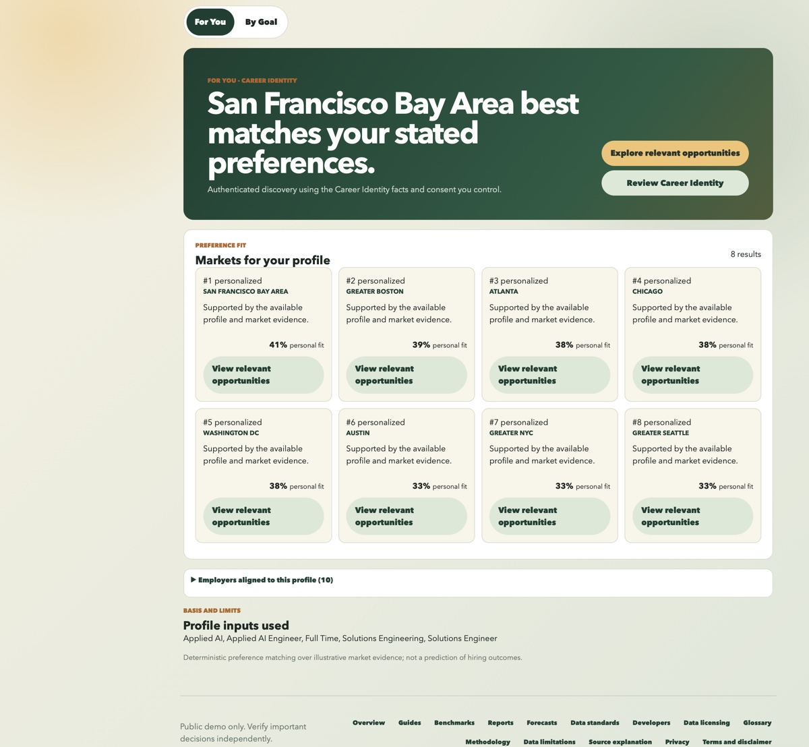
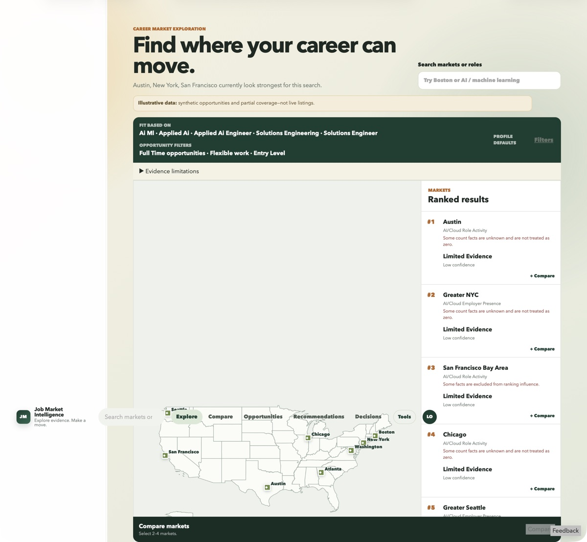
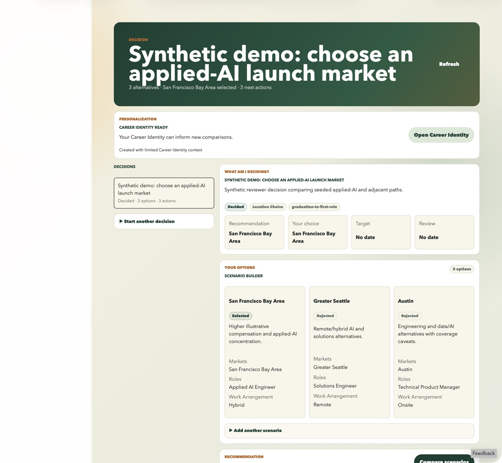

# Job Market Intelligence

Job Market Intelligence is a geographic career-decision application for exploring labor markets and employers, finding relevant opportunities, comparing markets, and turning evidence into a practical next step.

**Live demo:** [Open Job Market Intelligence](https://job-market-intelligence-demo.onrender.com) — guest changes are temporary and may reset.

[What it does](#what-it-does) · [Engineering](#engineering-highlights) · [Run locally](#run-locally) · [Documentation](#documentation)

## What it does

- Explores labor markets and employer presence from a role, industry, or geographic starting point.
- Filters governed demonstration opportunities by market, role family, type, work arrangement, freshness, and strategic relevance.
- Compares selected markets with evidence, confidence, coverage, and trade-offs kept visible.
- Separates consent-aware, user-scoped Career Identity discovery from shared goal-based market ranking.
- Carries alternatives and recommendations into versioned career decisions, next actions, and application tracking.

| Explore markets | Make a decision |
|---|---|
|  |  |

More views: [market comparison](docs/assets/portfolio/market-comparison.jpg), [current opportunities](docs/assets/portfolio/current-opportunities.jpg), [Career Identity](docs/assets/portfolio/career-identity.jpg), and [all portfolio screenshots](docs/assets/portfolio/).

## Engineering highlights

- **Evidence-aware data:** conclusions retain provenance, coverage, confidence, freshness, and the distinction between unknown values and observed zeroes.
- **Governed opportunities:** source policy, canonical identity, status, coverage, and eligibility determine whether an observation can be displayed or ranked.
- **Explainable recommendations:** declared goal profiles produce deterministic rankings, reasons, trade-offs, watchlists, and abstentions without claiming trained machine learning.
- **User-owned personalization and decisions:** Career Identity is consent-aware, versioned, and isolated to the current guest session or signed-in user; it remains separate from goal rankings.
- **Reproducible local application:** Alembic migrations and an idempotent portfolio seed create the SQLite demonstration without paid services or external data calls.

See [Decision Intelligence](docs/DECISION_INTELLIGENCE.md) for the recommendation boundary and the [engineering guide](docs/ENGINEERING_GUIDE.md) for architecture, security, deployment, and verification.

## Tech stack

- **Frontend:** React 19, TypeScript, Vite 7
- **Backend:** Python 3.11, FastAPI, Pydantic, SQLAlchemy 2, Alembic
- **Data and verification:** SQLite locally, optional PostgreSQL support, pytest, Vitest, ESLint, Ruff

## Run locally

The verified baseline is Python 3.11, Node.js 22, npm 10 or newer, and SQLite. No Auth0 tenant, external AI API, commercial database, or paid service is required. Follow the **[local setup guide](docs/LOCAL_SETUP.md)** for installation, migrations, the portfolio seed, startup, verification, and troubleshooting.

## Demonstration data and limitations

The bundled markets, employer observations, compensation figures, and opportunities are synthetic or illustrative demonstration data. They are not live employer listings, validated nationwide labor-market conditions, hiring probabilities, or evidence of career outcomes. Reserved `.example` links cannot be used to apply for jobs.

The application exercises real ingestion, persistence, governance, matching, ranking, personalization, and decision workflows. Its evaluation establishes deterministic behavior and internal contract consistency—not predictive accuracy. See [Decision Intelligence](docs/DECISION_INTELLIGENCE.md) for the scoring, evidence, personalization, and abstention boundaries.

## Documentation

- [Local setup](docs/LOCAL_SETUP.md) — installation, database initialization, startup, checks, and troubleshooting.
- [Engineering guide](docs/ENGINEERING_GUIDE.md) — current architecture, security, deployment, operations, and testing.
- [Decision Intelligence](docs/DECISION_INTELLIGENCE.md) — By Goal ranking, For You discovery, evidence semantics, and evaluation limits.
- [Documentation index](docs/README.md) — specialized references and clearly separated historical records.

## License and attribution

The original project code is available under the [MIT License](LICENSE). Dependencies retain their own licenses. The map uses public-domain U.S. Census Bureau state geometry; [source and transformation details](data/geography/README.md) are included in the repository.
