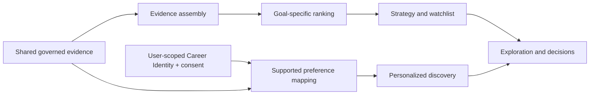

# Decision Intelligence

Job Market Intelligence uses deterministic, evidence-governed analytics to rank markets and employers, match demonstration opportunities, assemble career strategies, and preserve decisions. It is not a trained recommender, predictive hiring model, or autonomous career counselor.

## Two recommendation paths

| Path | Inputs | Output | Identity behavior |
|---|---|---|---|
| **By Goal** | Shared market/employer evidence and one declared objective | Ranked targets, explanations, trade-offs, fallback/watchlist strategy | Public; Career Identity does not alter the result |
| **For You** | Shared evidence plus the current user's supported, consented Career Identity facts | Deterministic preference-fit markets and employers | User-scoped; labeled personalized only when identity context was applied |

`POST /recommendations/strategy` implements **By Goal**. `POST /me/discover/personalized` implements **For You**. The Recommendations screen presents both, but their inputs, scores, and algorithms are not combined.



## Goal-based ranking

[`assembly.py`](../backend/recommendations/assembly.py) binds facts to explanations and evidence references. [`goal_modes.py`](../backend/recommendations/goal_modes.py) declares seven component and penalty profiles. [`ranking.py`](../backend/recommendations/ranking.py) computes each result, and [`strategy.py`](../backend/recommendations/strategy.py) selects actionable or watchlist targets.

For a goal mode:

```text
score = clamp(sum(component_value × goal_weight) - sum(penalties), 0, 1)
```

Missing components are recorded and skipped; they are not converted to zero, and weights are not silently renormalized. Proxy components remain labeled. Ordering is stable by descending score, case-insensitive display label, then target ID.

The modes emphasize entry-level access, prestige, AI/cloud concentration, underrated markets, internship/co-op access, lower competition, or geographic flexibility. They operate over the same governed evidence with different declared priorities. Fixture-specific winners are documented in the [portfolio evaluation](evaluation/PORTFOLIO_INTELLIGENCE_EVALUATION.md); they are internal consistency expectations, not real-world market endorsements.

## Strategy, evidence, and abstention

Strategy selection uses transparent thresholds:

- primary targets normally require a score of at least `0.55` and no watchlist condition;
- secondary or fallback targets normally require at least `0.35` and no watchlist condition;
- a score of at least `0.45` can remain on the watchlist when evidence is weak, materially incomplete, or missing provenance.

If no result clears the primary threshold but the leading item has no watchlist condition, it may remain the sole primary target. Weak evidence is not promoted simply to fill a strategy. Unsupported goals and blocking contradictions can abstain.

Source observations preserve provenance rather than becoming product truth on ingestion. Coverage can be `production_ready`, `limited`, `experimental`, or `unsupported`; an absent or weak coverage contract is not treated as proof that no opportunity exists. Current Opportunities separately requires active canonical status, an active and permitted source link, usable coverage, sufficient identity resolution, and explicit display or ranking eligibility.

Counts carry both a value and a status. `None/unknown` means the system lacks a supported observation; `0/zero_observed` means a governed source observed zero. The distinction prevents missing evidence from becoming a false negative conclusion.

## Career Identity personalization

[`build_personalization_from_career_identity`](../backend/career_identity/personalization.py) applies identity context only when downstream-personalization consent is present. It maps these supported facts:

- role function, role title, and employment type;
- preferred or excluded industries;
- resolvable target, acceptable, or excluded geographic constraints.

Other Career Identity facts—including education, experience, skills, projects, credentials, career goals, compensation, timing, and work-arrangement preferences—may be stored but do **not** alter the current personalized-discovery request. Skill and experience counts are response metadata only. This limitation is intentional and prevents the interface from implying personalization the adapter does not perform.

The user boundary may come from the backend-issued session in the public guest demo, the verified local development identity, or configured OIDC/Auth0 authentication. Guest access does not require account creation, but its Career Identity is still isolated to that guest session. Without a Career Identity or consent, request inputs remain unchanged and the response is not labeled as Career Identity personalization. Focused API tests verify identity sensitivity, consent behavior, determinism, and cross-user isolation.

## Decisions and versioning

Career decisions preserve the context snapshot, alternatives, recommendation, selection, action plan, outcome, and an append-only version journal. Mutations create a new version rather than rewriting historical state. Career Identity writes use expected-version checks and return `VERSION_CONFLICT` for stale updates.

The user-owned **My Search** workspace carries a selected priority into next actions and application tracking. Application status changes are explicit; opening an external demonstration link does not silently mark an application as submitted.

## Evaluation limits

The executable portfolio authority is [`tests/integration/test_portfolio_demo_batch1.py`](../tests/integration/test_portfolio_demo_batch1.py), supported by recommendation, opportunity, Career Identity, and decision tests. The [evaluation guide](evaluation/PORTFOLIO_INTELLIGENCE_EVALUATION.md) summarizes the golden behaviors.

These checks establish deterministic behavior, contract consistency, scenario sensitivity, conservative failure behavior, consent, and isolation. They do not establish predictive accuracy, hiring probability, causal labor-market conclusions, nationwide coverage, or externally validated career outcomes.
