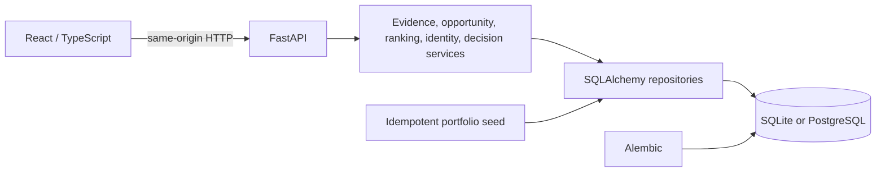

# Engineering Guide

This guide describes the completed local application and the hosted public guest demonstration. Historical layer documents remain delivery records; current source, tests, migrations, and this guide are authoritative when those records describe an older topology.

[Architecture](#architecture) · [Implementation paths](#representative-implementation-paths) · [Authentication and isolation](#authentication-and-isolation) · [Deployment](#deployment-architecture) · [Operations](#operations) · [Testing](#testing-and-verification)

## Architecture

The local path is a Vite development server, FastAPI, and SQLite. The hosted portfolio path is one Render service: FastAPI serves both the compiled React assets and the API, backed by ephemeral SQLite. Neither path requires Auth0, a managed database, a data provider, a paid API, or an LLM. PostgreSQL, Auth0, billing, institutional integrations, and provider ingestion remain separately configured capabilities.

### Main boundaries

| Area | Responsibility | Entry points |
|---|---|---|
| Frontend shell | Navigation, lazy routes, guest bootstrap, typed requests, URL restoration | [`ProductShell.tsx`](../frontend/src/ProductShell.tsx), [`PublicRoutes.tsx`](../frontend/src/PublicRoutes.tsx), [`guestSession.ts`](../frontend/src/guestSession.ts), [`api.ts`](../frontend/src/api.ts) |
| Geographic outputs | Canonical regions, employers, comparisons, assembled evidence | [`routes.py`](../backend/api/routes.py), [`service.py`](../backend/outputs/service.py) |
| Opportunities | Provider observations, canonical records, source and eligibility policy | [`current_opportunities.py`](../backend/api/current_opportunities.py), [`service.py`](../backend/current_opportunities/service.py) |
| Recommendations | Evidence assembly, seven goal profiles, deterministic ranking and strategy | [`assembly.py`](../backend/recommendations/assembly.py), [`goal_modes.py`](../backend/recommendations/goal_modes.py), [`ranking.py`](../backend/recommendations/ranking.py), [`strategy.py`](../backend/recommendations/strategy.py) |
| User state | Career Identity, personalization, decisions, actions, and applications | [`career_identity/`](../backend/career_identity/), [`personalized.py`](../backend/api/personalized.py), [`career_decisions/`](../backend/career_decisions/), [`users/`](../backend/users/) |
| Runtime | App assembly, schema evolution, deterministic seed, guest sandbox | [`app.py`](../backend/api/app.py), [`alembic/`](../alembic/), [`portfolio_seed.py`](../seeds/portfolio_seed.py), [`public_guest/`](../backend/public_guest/) |

[`App.tsx`](../frontend/src/App.tsx) also coordinates older account and institutional surfaces. Those capabilities are not prerequisites for the portfolio journey and are denied in the public guest runtime unless an exact route is explicitly allowed.

## Representative implementation paths

### Exploration, opportunities, and recommendations

`ExplorePage` persists typed URL state and calls region, search, and comparison routes through `api.ts`. [`OutputAssemblyService`](../backend/outputs/service.py) joins canonical geography with company presence, hiring, entry-level, score, freshness, and coverage records. The browser presents this governed read model; it does not invent a presentation-only score.

[`CurrentOpportunityService`](../backend/current_opportunities/service.py) requires acceptable source policy, coverage, identity resolution, canonical status, and explicit display or ranking eligibility. Ingestion alone does not authorize an opportunity, and the portfolio's reserved `.example` destinations remain labeled demonstration records.

[`RecommendationExperience.tsx`](../frontend/src/RecommendationExperience.tsx) exposes two separate paths. **By Goal** sends one of seven declared modes to `/recommendations/strategy`; evidence assembly, ranking, and strategy produce stable scores, explanations, fallbacks, watchlists, or abstention. **For You** calls `/me/discover/personalized`; it applies only supported, consented Career Identity facts. The two paths do not share scores or silently change each other's inputs. See [Decision Intelligence](DECISION_INTELLIGENCE.md).

### User-owned state and evidence

Career Identity writes validate vocabulary, consent, privacy, provenance, state transitions, and `expected_version`. Decision services retain context, alternatives, recommendations, selection, action plans, and outcomes; meaningful mutations append a [`DecisionVersion`](../backend/career_decisions/models.py) rather than overwriting history. Ownership checks use the resolved internal user ID, not a client-supplied owner.

Raw source observations remain separate from canonical records. Coverage contracts determine where evidence is sufficient for display or ranking; freshness is evaluated independently, and unknown is never coerced to observed zero. The main implementations are [`backend/provenance/`](../backend/provenance/) and [`coverage.py`](../backend/imports/coverage.py).

## Authentication and isolation

The repository supports distinct identity boundaries:

- `local` and `test` may use the development verified-claims bridge. The frontend's `VITE_LOCAL_AUTH=true` identity and backend `X-Verified-OIDC-Claims` handling are rejected outside those environments.
- `private_demo` supports restricted demonstrations with an explicitly configured database and normal authenticated mutation boundaries.
- Configured staging or production environments can validate OIDC/Auth0 bearer tokens and map provider, issuer, and subject to an internal user.
- `public_demo` is the older fail-closed, read-only public mode.
- The deployed portfolio uses `public_guest_demo`, a mutable but isolated guest sandbox. It does not require Auth0 or create a shared reviewer persona.

In guest mode, [`guest_sessions.py`](../backend/api/guest_sessions.py) asks [`public_guest/service.py`](../backend/public_guest/service.py) to create a random session token, store only its digest, and provision a distinct internal user. The token is returned as the secure, `HttpOnly`, `SameSite=Lax`, same-origin `__Host-jmi_guest` cookie. The CSRF token is returned separately and held in browser memory by [`guestSession.ts`](../frontend/src/guestSession.ts).

[`PublicGuestMiddleware`](../backend/public_guest/middleware.py) resolves the cookie to an unexpired principal. Unsafe requests require that principal, an exact allowed `Origin` or `Referer`, a same-site fetch context, and the matching CSRF token. Session mutation serialization and per-entity limits reduce races and bound resource use. [`dependencies.py`](../backend/api/dependencies.py) resolves the guest to its internal user for normal ownership checks and denies privileged role resolution.

Access is fail closed: [`policy.py`](../backend/public_guest/policy.py) contains exact method-and-route templates for the portfolio journey, and an inventory test detects newly exposed routes. Administrative, billing, institutional, integration, provider-ingestion, and other privileged actions are unavailable. Settings enforce an eight-hour session lifetime, issuance and request-rate limits, a cap on active sessions, a per-session mutation budget, entity quotas, request-size limits, and a maximum SQLite file size. The concrete bounds and environment validation live in [`settings.py`](../backend/config/settings.py); security headers and general rate limiting live in [`protection.py`](../backend/api/protection.py).

This design isolates demonstration state and limits casual abuse. It is not a claim of commercial multi-tenant security, independent penetration testing, or horizontally scalable session enforcement.

## Deployment architecture

[`render.yaml`](../render.yaml) defines one Render Free web service. Its build installs Python dependencies, compiles the React application in `public_guest_demo` mode, and records the Render Git commit as the release ID. Uvicorn runs one worker. [`static.py`](../backend/public_guest/static.py) serves the compiled assets and SPA fallback from FastAPI, so browser and API requests are same-origin.

At process startup, the FastAPI lifespan in [`app.py`](../backend/api/app.py) calls [`lifecycle.py`](../backend/public_guest/lifecycle.py). It upgrades the SQLite database to the Alembic head and idempotently applies the MVP and portfolio seeds. Guest startup explicitly excludes and checks for the old shared reviewer identity. The deployed database is `/tmp/jmi-public-guest.db`; it is runtime-local, not a hosted durable database.

Public guest settings require SQLite, HTTPS, a canonical same-origin URL, security protections, disabled API docs, and a release ID. They reject Auth0 and Stripe secrets. The backend contract is documented in [`.env.example`](../.env.example); frontend modes are in [`frontend/.env.example`](../frontend/.env.example) and enforced by [`runtimeConfig.ts`](../frontend/src/runtimeConfig.ts). Other staging or production configurations may use PostgreSQL and Auth0, but they are not the topology of the public portfolio demo.

## Operations

`GET /health` is process liveness. `GET /ready` verifies database access, initialization, and that the schema matches the expected Alembic head; Render uses readiness as its health check. A Free service can cold-start, so the frontend allows guest bootstrap extra time and shows an unavailable state instead of enabling unauthenticated mutations.

Guest sessions expire after eight hours. A stale, revoked, or otherwise unusable guest cookie can be replaced through the bounded bootstrap flow, and the frontend can recover once from a CSRF mismatch when replay is safe. Refreshing the application does not intentionally discard a valid session, but SQLite under `/tmp` is temporary: guest changes may disappear after a restart, redeploy, or platform lifecycle event.

Runtime configuration lives in `render.yaml` and the two example environment files. Application responses carry an `x-request-id`; backend logs include request and initialization failures, while Render provides process and deploy logs. A practical failure check is:

1. Check `/health`, then `/ready` for schema or initialization failure.
2. Inspect the Render deploy/runtime log and correlate any response request ID.
3. Verify the release and public-guest environment contract, then look for migration, seed, database-capacity, or session-issuance errors.
4. After service recovery, reload to bootstrap a new guest only if the previous temporary session is no longer valid.

SQLite, an in-memory rate limiter, local guest locks, and one worker deliberately match the small public demonstration. They do not provide shared enforcement, durable visitor data, backups, zero-downtime migration guarantees, or horizontal scale. Reproducing the demo requires the repository, locked dependencies, the Render descriptor or equivalent single-process host, and permission to create the temporary SQLite file; it does not require restoring visitor data.

## Engineering decisions and trade-offs

| Decision | Consequence |
|---|---|
| Preserve unknown versus observed zero | Missing evidence cannot create a false negative conclusion. |
| Fail closed on source, coverage, and guest routes | Unsupported records and newly added routes do not gain authority by default. |
| Keep ranking deterministic and abstention explicit | Formulas, penalties, tie-breaks, weak evidence, and no-result cases remain inspectable. |
| Separate identity personalization from goal ranking | User preferences cannot silently alter a shared goal comparison. |
| Version user-owned state | Stale profile writes conflict and decision history remains inspectable. |
| Favor reproducible SQLite fixtures | Local and guest demonstrations need no hosted dependency, at the cost of durable and horizontally scaled state. |

The repository retains institutional, billing, integration, public-report, and operational components beyond the portfolio journey. Their presence demonstrates bounded modules, not availability in the guest sandbox or a claim that the repository is a commercially operated SaaS platform.

## Testing and verification

Backend tests under [`tests/`](../tests/) cover services, routes, migrations, seed behavior, authorization, ownership, recommendations, and recovery. [`test_public_guest_runtime.py`](../tests/test_public_guest_runtime.py) exercises fail-closed route inventory, cookie and CSRF enforcement, spoofing resistance, cross-guest isolation, expiry and reset, quotas, initialization, and concurrent guest reads and mutations. Recommendation and portfolio fixtures verify stable ordering, seven goal modes, evidence handling, consent, scenario sensitivity, and user isolation.

Frontend tests live beside the React code. [`guestSession.test.tsx`](../frontend/src/guestSession.test.tsx) covers bootstrap without login, in-memory CSRF use, stale-session replacement, bounded CSRF recovery, and non-replay of uncertain failures. Page and route tests cover exploration, opportunities, recommendations, identity, and decisions.

[`.github/workflows/ci.yml`](../.github/workflows/ci.yml) runs backend lint and tests, frontend lint/tests/build, and a fresh Alembic migration plus repeat-seed check. Executable portfolio cases live in [`test_portfolio_demo_batch1.py`](../tests/integration/test_portfolio_demo_batch1.py), with claims and limits summarized in the [portfolio evaluation](evaluation/PORTFOLIO_INTELLIGENCE_EVALUATION.md). Use [Local Setup](LOCAL_SETUP.md#verification) for commands rather than treating historical acceptance reports as current instructions.

Repository tests establish deterministic contracts, conservative failure behavior, access boundaries, and reproducibility. The reachable hosted `/health` and `/ready` endpoints and a browser walkthrough establish that the deployed release starts and serves the portfolio flow. The repository does not contain evidence of independent penetration testing, sustained hosted load or multi-worker scale, predictive validity, comprehensive browser/device certification, continuously maintained employment coverage, or career outcomes.
