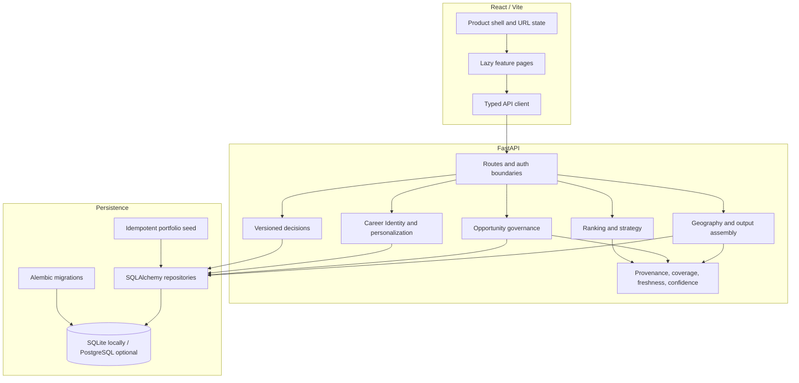

# Engineering Guide

This guide describes the implemented application. Historical layer documents remain available as delivery records, but this guide and the linked source are the shortest path for technical review.

[Architecture](#architecture) · [Implementation paths](#representative-implementation-paths) · [Decisions](#engineering-decisions-and-trade-offs) · [Verification](#verification)

## Architecture



The local path is a React client, a FastAPI process, and SQLite. It does not require a managed database, Auth0 tenant, live data provider, queue, cache, paid API, or LLM. PostgreSQL, Auth0, billing, institutional integrations, and hosted operations exist as optional paths rather than local prerequisites.

### Main boundaries

| Area | Responsibility | Entry points |
|---|---|---|
| Frontend shell | Navigation, lazy routes, typed requests, URL restoration | [`ProductShell.tsx`](../frontend/src/ProductShell.tsx), [`PublicRoutes.tsx`](../frontend/src/PublicRoutes.tsx), [`api.ts`](../frontend/src/api.ts), [`urlState.ts`](../frontend/src/urlState.ts) |
| Geographic outputs | Canonical regions, employers, comparisons, assembled evidence | [`routes.py`](../backend/api/routes.py), [`service.py`](../backend/outputs/service.py) |
| Opportunities | Provider observations, canonical records, source and eligibility policy | [`current_opportunities.py`](../backend/api/current_opportunities.py), [`service.py`](../backend/current_opportunities/service.py) |
| Recommendations | Evidence assembly, declared goal profiles, ranking, strategy | [`assembly.py`](../backend/recommendations/assembly.py), [`goal_modes.py`](../backend/recommendations/goal_modes.py), [`ranking.py`](../backend/recommendations/ranking.py), [`strategy.py`](../backend/recommendations/strategy.py) |
| User state | Career Identity, consented personalization, decisions, version history | [`career_identity/`](../backend/career_identity/), [`personalized.py`](../backend/api/personalized.py), [`career_decisions/`](../backend/career_decisions/) |
| Reproducibility | Schema evolution and deterministic demonstration construction | [`alembic/`](../alembic/), [`seed_demo.py`](../scripts/seed_demo.py), [`portfolio_seed.py`](../seeds/portfolio_seed.py) |

[`App.tsx`](../frontend/src/App.tsx) still coordinates older account and institutional surfaces with shared request state. Flagship and public routes are code-split, but a broader state-management rewrite was intentionally kept outside the portfolio refinement.

## Representative implementation paths

### Geographic exploration and comparison

`ExplorePage` reads and writes typed URL state, then calls region, search, and comparison routes through `api.ts`. [`OutputAssemblyService`](../backend/outputs/service.py) joins canonical geography with company presence, hiring, entry-level, score, freshness, and coverage records. The resulting comparison is a governed backend read model rather than a score created for presentation in the browser.

### Governed opportunity discovery

[`CurrentOpportunitiesPage.tsx`](../frontend/src/CurrentOpportunitiesPage.tsx) serializes the active filters. [`CurrentOpportunityService`](../backend/current_opportunities/service.py) evaluates canonical status, source links and policy, coverage, identity resolution, display eligibility, and ranking eligibility. Provider ingestion alone never grants authority to display or rank an item, and reserved `.example` destinations remain labeled demonstration records.

### Public goal-based recommendations

[`RecommendationExperience.tsx`](../frontend/src/RecommendationExperience.tsx) requests one of seven declared goal modes. Assembly binds evidence, ranking resolves available components and penalties with stable ordering, and strategy selects primary, secondary, fallback, or watchlist targets. This public path uses the chosen goal and shared evidence; it does not receive Career Identity.

### Authenticated personalized discovery

`POST /me/discover/personalized` resolves the current user and calls [`build_personalization_from_career_identity`](../backend/career_identity/personalization.py). The adapter checks consent and maps only supported role, industry, and geographic facts. The response is presented as Career Identity personalization only when its metadata confirms that identity context was applied. This path and public goal ranking intentionally use different inputs and scores.

### Career Identity and decisions

Career Identity writes validate controlled vocabulary, privacy, provenance, state transitions, and `expected_version`. Decision services persist context, alternatives, recommendations, selection, action plans, and outcomes; each meaningful mutation appends a [`DecisionVersion`](../backend/career_decisions/models.py) journal row.

### Evidence and coverage

Raw source observations remain separate from canonical records. Coverage contracts determine where the system has enough governed evidence to support display or ranking. Freshness is evaluated separately, and an unknown value is never coerced into an observed zero. See [`backend/provenance/`](../backend/provenance/) and [`coverage.py`](../backend/imports/coverage.py).

## Engineering decisions and trade-offs

| Decision | Consequence | Representative verification |
|---|---|---|
| Preserve unknown vs. observed zero | Missing evidence cannot create a false negative conclusion | portfolio opportunity and output tests |
| Fail closed on coverage and source policy | Unsupported records cannot imply exhaustive absence or enter rankings | current-opportunity service tests |
| Keep ranking deterministic | Goal profiles, formulas, penalties, and tie-breaks remain inspectable | recommendation ranking and strategy tests |
| Make abstention first-class | Weak or unsupported evidence can remain watchlisted or produce no action | market-intelligence and strategy tests |
| Separate identity personalization from goal ranking | Authenticated preferences cannot silently alter a public comparison | personalized API and portfolio integration tests |
| Version user-owned state | Stale profile writes conflict; decision history is append-only | Career Identity and decision tests |
| Favor a reproducible local boundary | Migrations plus an idempotent seed construct the same logical fixture without hosted dependencies | seed, migration, and portfolio integration tests |

The main deliberate compromise is breadth: the repository retains additional institutional, billing, public-report, and operations surfaces beyond the core portfolio journey. Route boundaries and reviewer guides keep those from becoming prerequisites for understanding or running the main application.

## Verification

High-signal portfolio and recommendation checks:

```bash
APP_ENV=test .venv/bin/pytest -q tests/integration/test_portfolio_demo_batch1.py
APP_ENV=test .venv/bin/pytest -q \
  tests/test_recommendation_ranking.py \
  tests/test_recommendation_strategy.py \
  tests/test_recommendation_assembly.py \
  tests/test_api_personalized.py

cd frontend
npm test -- ProductShell.test.tsx RecommendationExperience.test.tsx publicRoutes.test.tsx
npm run build
```

See [`LOCAL_SETUP.md`](LOCAL_SETUP.md) for complete installation and verification commands. The [portfolio evaluation](evaluation/PORTFOLIO_INTELLIGENCE_EVALUATION.md) describes what the golden scenarios do and do not establish.
